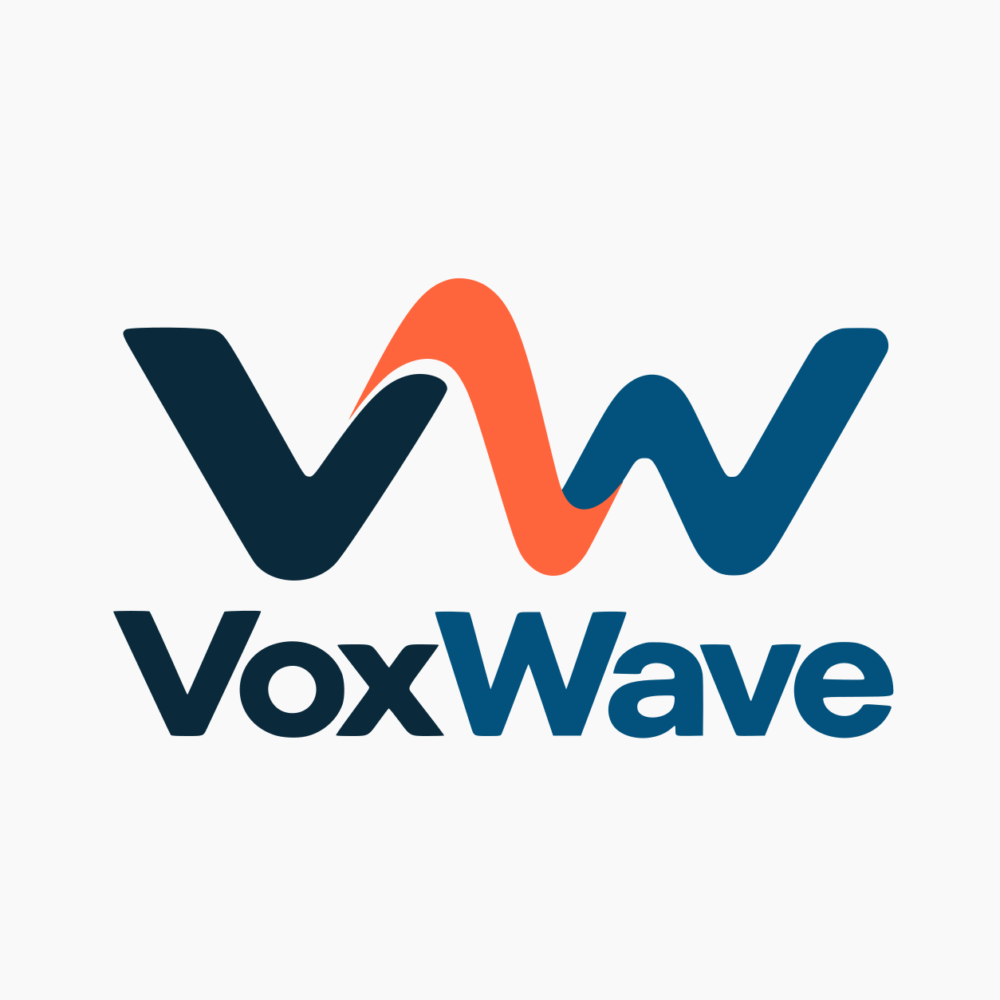

<p align="center"></p>

# VoxWave · investigación del modelo de voz

Modelo de IA que detecta cambios en la voz asociados al Parkinson y los vigila en el tiempo frente a la
referencia personal de cada usuario. Proyecto de la Universidad Complutense de Madrid para Creative
Shock 2026. **Prototipo de investigación: monitorización, no diagnóstico.**

> **English summary.** Speech model for Parkinson's-related voice change. A frozen WavLM Base+ with
> in-fold channel residualization reaches AUROC 0.91 (95% CI 0.86–0.96) on NeuroVoz under speaker-level
> cross-validation, 0.89 on an age-matched subset, and its index tracks UPDRS beyond age and sex
> (partial ρ 0.49). Without retraining it scores 0.79 on MDVR-KCL (English) and 0.93 on ItalianPVS. We
> show that NeuroVoz carries a strong recording-channel shortcut (silence alone predicts diagnosis,
> AUROC 0.83) and that fine-tuned models learn it. Full write-up: [paper/VoxWave_paper.pdf](paper/VoxWave_paper.pdf).

## Resultado en una tabla

| Prueba | AUROC |
|---|---|
| NeuroVoz, modelo principal (WavLM Base+ congelado, canal descontado), CV por hablante | **0,91** (0,86-0,96) |
| NeuroVoz, subconjunto emparejado por edad | 0,89 |
| Control: solo el silencio de las grabaciones | 0,83 ← atajo de la sala |
| Fine-tuning contrastivo (SupCon) | 0,96, pero cae a 0,67 al descontar el canal |
| MDVR-KCL (inglés, misma sala para todos), sin reentrenar | 0,79 lectura / 0,74 diálogo |
| ItalianPVS (italiano), sin reentrenar | 0,93 (el canal solo da 0,90: el corpus tiene su propio atajo) |
| Entrenado sin datos en castellano → NeuroVoz | 0,83 |

Dentro del grupo con Parkinson, el índice correlaciona con UPDRS-III (ρ parcial 0,49, p = 0,0008).
NeuroVoz es transversal, así que el seguimiento se ha validado solo por simulación (regla de aviso
calibrada en ~3 % de falsas alarmas) y con UCI Telemonitoring (las vocales sostenidas no siguen la
progresión). Detalle, controles y limitaciones: [ml/RESULTADOS.md](ml/RESULTADOS.md).

## Estructura

```
voxwave-research/
├── README.md               este archivo
├── NEXT_STEPS.md           hoja de ruta: qué falta y por dónde seguir
├── paper/                  paper en inglés (PDF) y su fuente HTML + script de compilación
├── ml/                     pipeline completo
│   ├── README.md           instalación, reglas de evaluación y orden de ejecución de los scripts
│   ├── RESULTADOS.md       todos los resultados, con su interpretación (castellano)
│   ├── src/                scripts (rasgos, modelos, controles, validación externa, seguimiento, API)
│   ├── tests/              tests de pytest
│   ├── results/            resúmenes agregados (JSON), ranking de diales y figuras
│   └── export/CONTRATO.md  contrato de datos y API para la demo web del equipo
├── docs/
│   ├── project/            contexto del proyecto VoxWave y plan inicial del equipo
│   ├── research/           investigaciones bibliográficas hechas con Gemini y ChatGPT
│   └── guides/             cómo conseguir cada dataset
├── data/                   NeuroVoz (no incluido; ver data/README.md)
└── data_external/          MDVR-KCL, ItalianPVS, UCI (no incluidos)
```

## Empezar

1. Lee el [paper](paper/VoxWave_paper.pdf) o, más corto, la sección 0 de [ml/RESULTADOS.md](ml/RESULTADOS.md).
2. Consigue los datos: [docs/guides/datasets.md](docs/guides/datasets.md). NeuroVoz se pide en Zenodo
   (licencia de investigación no comercial).
3. Instala y ejecuta el pipeline siguiendo [ml/README.md](ml/README.md):

```bash
cd ml
python -m venv .venv
.venv/Scripts/python.exe -m pip install -r requirements.txt
.venv/Scripts/python.exe -m pytest -q tests
cd src
../.venv/Scripts/python.exe make_folds.py
../.venv/Scripts/python.exe extract_egemaps.py
```

(En Linux/macOS, `.venv/bin/python` en lugar de `.venv/Scripts/python.exe`.)

4. Elige un frente en [NEXT_STEPS.md](NEXT_STEPS.md).

## Decisiones que conviene conocer antes de tocar nada

- **Validación por hablante siempre.** Cada persona tiene ~27 grabaciones (17 de frases y pa-ta-ka); mezclar grabaciones de la
  misma persona entre train y test infla la cifra.
- **El canal es el enemigo.** En NeuroVoz, PD y HC se grabaron en épocas y condiciones distintas. Todo
  modelo nuevo debe reportar el control de solo canal, el de solo silencio, el subconjunto emparejado
  por edad y la ventana de grabación compartida (nov-dic 2016).
- **El modelo principal se fijó antes de mirar los tests externos.** WavLM Large puntúa más (0,95), pero
  no se adoptó para no elegir el modelo con los datos de prueba.
- **El seguimiento compara a cada persona consigo misma**, con el mismo dispositivo y solo en sesiones
  en ON: el efecto ON/OFF de la levodopa sobre la voz es del orden de un año de progresión.

## Investigación previa con IA

[docs/research/](docs/research/) recoge los informes bibliográficos que el equipo pidió a Gemini y
ChatGPT (sesgo de canal, biomarcadores robustos, levodopa y fluctuaciones, regulación, DA-DSQA y
SupCon, variabilidad en el seguimiento). Son material generado por IA: sirvieron para orientar el
trabajo, pero sus citas y cifras deben comprobarse en la fuente antes de reutilizarlas. Las que se
usaron en el paper se verificaron.

## Datos y licencias

- **Código**: MIT ([LICENSE](LICENSE)). **Paper y documentación**: CC BY 4.0.
- **Ningún dato de pacientes está en el repositorio.** NeuroVoz (CC BY-NC-ND 4.0) no permite
  redistribuir sus audios ni sus derivados; por eso no se incluyen rasgos, puntuaciones por paciente,
  folds ni modelos entrenados. Todo se regenera con los scripts.
- **Los modelos entrenados con NeuroVoz no pueden usarse con fines comerciales.** Un producto necesitará
  datos propios (piloto) o corpus con licencia abierta.
- La demo web del proyecto (vox-wave-demo) vive en el repositorio de otro miembro del equipo.

## Autores

Martín Reboll Gómez, Javier de Paz Figueras, Marco García López y Victor Verdú García (Universidad
Complutense de Madrid). Cómo citar: [CITATION.cff](CITATION.cff).
